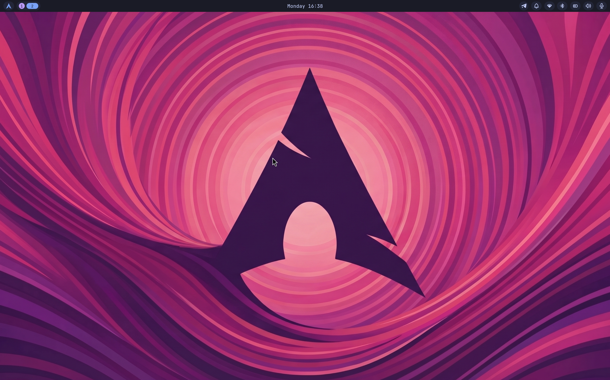
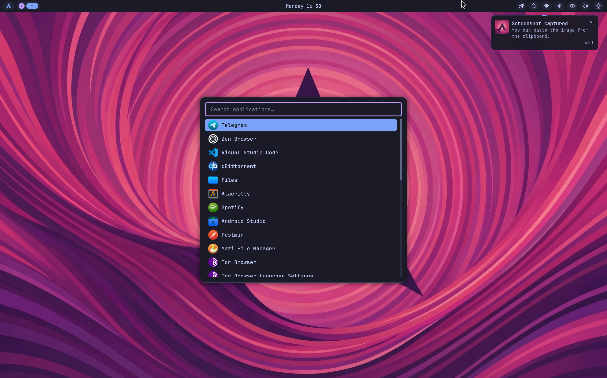
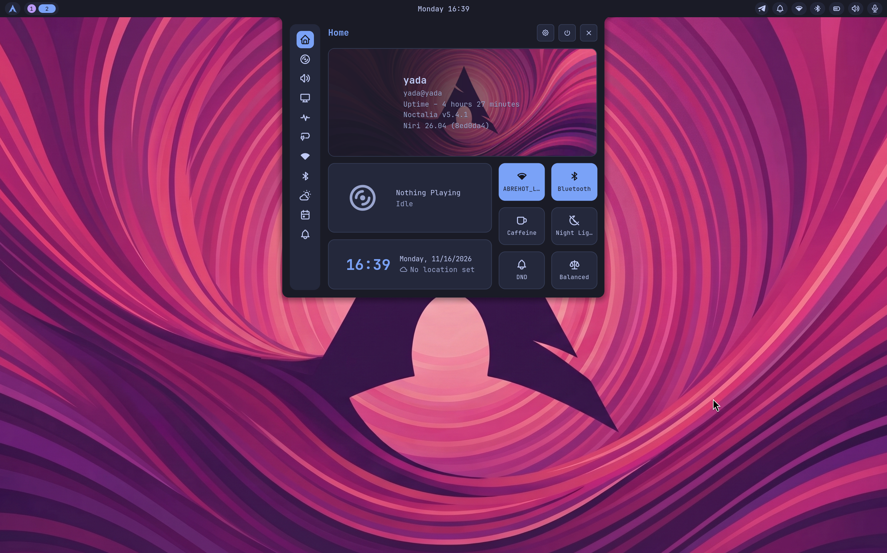

<p align="center">
   
</p>

<h1 align="center">ydot</h1>

<p align="center">
  Personal Arch Linux + Niri dotfiles with a centralized theme system and Noctalia shell.<br/>
  All configurations deploy via GNU Stow.
</p>

<p align="center">
  
  
  <a href="https://github.com/yaredow/nixos-config"></a>
</p>

<p align="center">
  
</p>

<p align="center">
  
  
</p>

> [!TIP]
> Also running NixOS? Check out the NixOS variant of this configuration at [yaredow/nixos-config](https://github.com/yaredow/nixos-config).

---

## Highlights

- **Scrollable Tiling Compositor** — Driven by [Niri](https://github.com/YaLTeR/niri) with smooth animations, column resizing, and dynamic multi-monitor layout.
- **Modern Desktop Shell** — [Noctalia](https://github.com/noctalia-dev/noctalia) provides the top bar, launcher, control center, volume/brightness OSDs, screen recorder widget, and lock screen.
- **Centralized Theming** — Tokyo Night theme orchestrator (`theme-set.sh`) styles Alacritty, Kitty, Fastfetch, Btop, Starship, Neovim, Herdr, RMPC, Zen Browser, and GTK.
- **Streamlined Login** — [greetd](https://man.sr.ht/~kennylevinsen/greetd/) paired with `noctalia-greeter` for a smooth, unified Wayland greeting experience.
- **Hardware & Remaps** — [keyd](https://github.com/rvaiya/keyd) remaps Caps Lock to Esc when tapped and Ctrl when held.
- **Per-Tool Stow Packages** — Every tool is an isolated stow package; pick and install only what you need.

> [!NOTE]
> **Environment**
>
> - **OS:** Arch Linux
> - **Compositor:** [Niri](https://github.com/YaLTeR/niri)
> - **Desktop Shell:** [Noctalia](https://github.com/noctalia-dev/noctalia)
> - **Greeter:** greetd + noctalia-greeter
> - **Terminal:** Alacritty (default) / Kitty
> - **Shell:** Fish + Starship
> - **Editor:** Neovim / Zed
> - **Browser:** [Zen Browser](https://zen-browser.app)
> - **Multiplexer:** [herdr](https://github.com/herdr-sh/herdr)
> - **Key Remap:** [keyd](https://github.com/rvaiya/keyd)

---

## Installation

### Fresh install

```sh
curl -fsSL https://raw.githubusercontent.com/yaredow/dotfiles/main/install.sh | sh
```

For a private fork:

```sh
DOTFILES_REPO="https://token@github.com/youruser/dotfiles.git" curl -fsSL ... | sh
```

### Existing setup

```sh
git clone https://github.com/yaredow/dotfiles ~/dotfiles
cd ~/dotfiles
./install.sh
```

### Options

```sh
./install.sh --check   # Pre-flight check only (tools, packages, conflicts) — no changes
./install.sh --help
```

- **Safe to re-run** — A failed run can be recovered by running `./install.sh` again.
- Files blocking GNU Stow are safely backed up to `~/.local/state/stow-backup-*/`.
- Installation is logged to `~/.local/state/dotfiles-install.log` (override with `DOTFILES_LOG`).

### Selective manual deployment

Pick and deploy just what you need using GNU Stow:

```sh
stow niri noctalia alacritty fish   # Deploy specific tools
stow -D kitty                       # Undeploy a tool
```

---

## Keybinds

`Mod` refers to the Super / Windows key.

### Shell & Applications

| Keys | Action |
|------|--------|
| `Mod + Return` / `Mod + T` | Open Terminal (Alacritty) |
| `Mod + B` | Open Browser (Zen Browser) |
| `Mod + Shift + Return` | Open Fastfetch in floating terminal |
| `Mod + Space` | Toggle Noctalia App Launcher |
| `Mod + S` | Toggle Noctalia Control Center |
| `Mod + Comma` | Toggle Noctalia Settings |
| `Mod + Ctrl + L` | Lock Screen |
| `Mod + Shift + /` | Hotkey overlay / Cheatsheet |
| `Mod + Shift + R` | Toggle Screen Recording (region) |

### Window Management & Navigation

| Keys | Action |
|------|--------|
| `Mod + Q` | Close window |
| `Mod + Shift + E` | Quit Niri |
| `Mod + H` / `Mod + Left` | Focus column left |
| `Mod + L` / `Mod + Right` | Focus column right |
| `Mod + J` / `Mod + Down` | Focus window down |
| `Mod + K` / `Mod + Up` | Focus window up |
| `Mod + Shift + H` / `Left` | Move column left |
| `Mod + Shift + L` / `Right` | Move column right |
| `Mod + Shift + J` / `Down` | Move window down |
| `Mod + Shift + K` / `Up` | Move window up |
| `Mod + 1-9` | Switch to workspace 1–9 |
| `Mod + Shift + 1-9` | Move column to workspace 1–9 |
| `Mod + Ctrl + J/K` | Focus workspace down / up |
| `Mod + R` | Switch preset column width (33% / 50% / 67%) |
| `Mod + F` | Maximize column |
| `Mod + Shift + F` | Fullscreen window |
| `Mod + C` | Center column |
| `Mod + V` | Toggle window floating |
| `Mod + W` | Toggle column tabbed display |
| `Mod + [` / `Mod + ]` | Consume / expel window into column |

### Media & Hardware

| Keys | Action |
|------|--------|
| `Print` / `Mod + Shift + S` | Interactive screenshot |
| `Ctrl + Print` | Fullscreen screenshot |
| `Alt + Print` | Focused window screenshot |
| `XF86AudioRaiseVolume` | Volume up (via Noctalia OSD) |
| `XF86AudioLowerVolume` | Volume down (via Noctalia OSD) |
| `XF86AudioMute` | Mute volume |
| `XF86MonBrightnessUp` | Brightness up |
| `XF86MonBrightnessDown` | Brightness down |

---

## Structure

Top-level directories are **per-tool stow packages** rooted at `~`, deployed cleanly with GNU Stow:

```
.
├── niri/           # Window manager (config.kdl)
├── noctalia/       # Desktop shell (config.toml, archlinux icon)
├── alacritty/      # Terminal emulator (alacritty.toml)
├── kitty/          # Terminal emulator (kitty.conf)
├── fish/           # Shell (config.fish, aliases, functions)
├── atuin/          # Shell history (config.toml, tokyo-night theme)
├── bat/            # Syntax-highlighting cat (config, tokyonight theme)
├── btop/           # Resource monitor (btop.conf)
├── fastfetch/      # Neofetch alternative (logo.txt)
├── fontconfig/     # Font rendering & fallbacks (fonts.conf)
├── git/            # Git configuration (delta, aliases)
├── gtk/            # GTK-3 & GTK-4 themes/settings
├── herdr/          # Terminal multiplexer (config.toml)
├── mpd/            # Music player daemon (mpd.conf)
├── mpv/            # Media player (mpv.conf, input.conf, scripts)
├── rmpc/           # MPD TUI client (config.ron)
├── electron/       # Wayland ozone flags
├── postman/        # Desktop entry
├── qbittorrent/    # Tokyo Night theme for qBittorrent
├── spotify/        # Spotify Wayland flags & launcher config
├── telegram/       # Tokyo Night theme for Telegram Desktop
├── yazi/           # Terminal file manager (keymap.toml)
├── youtube-tui/    # YouTube TUI client
├── zed/            # Code editor (settings.json, keymap.json)
├── zen/            # Zen Browser user.js, policies & vimium theme
├── bin/            # User scripts (~/.local/bin: theme-set, wallpaper, recording)
├── theme/          # Central palette (colors.json) & templates (*.tpl)
├── greetd/         # Greetd & noctalia-greeter system configuration
├── keyd/           # Keyd keyboard remap configuration (/etc/keyd/default.conf)
├── scripts/        # Non-stowed installer scripts, pacman.txt, yay.txt
└── install.sh      # Automated bootstrap installer
```

---

## Theming

Source of truth: `theme/.config/theme/themes/tokyonight/colors.json`.

```
theme-set.sh <name>
  ├─ render templates → alacritty / kitty / fastfetch / btop / starship / herdr / rmpc
  ├─ copy colors.json → ~/.config/quickshell/state/colors.json
  ├─ nvim integration → ~/.config/nvim/lua/theme.lua
  ├─ wallpaper via awww
  └─ state.json: theme.name + wallpaper.current
```

Edit templates under `theme/.config/theme/templates/*.tpl` and `colors.json` — never edit generated outputs directly.
